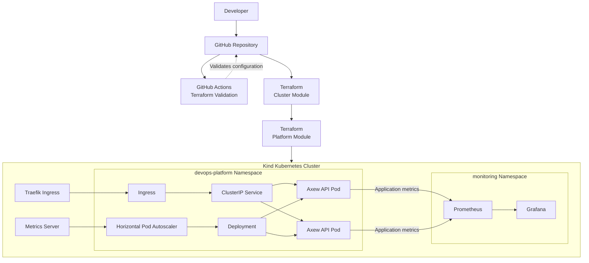

<p align="center">
  
  <strong><font size="16">AXEW</font></strong>
</p>

<p align="center">
  Infrastructure as Code · Kubernetes · DevOps · SRE
</p>

### Infrastructure as Code · Kubernetes · DevOps · SRE

**Axew** is a hands-on DevOps/SRE portfolio project focused on provisioning, deploying, and operating a Kubernetes platform using Infrastructure as Code (IaC).

The project demonstrates practical infrastructure automation, container orchestration, workload management, observability, autoscaling, CI validation, and operational troubleshooting through a reproducible local Kubernetes environment.

**Project status:** Core implementation completed.

---

## 🎯 Project Objectives

The main objective of Axew is to build and operate a reproducible Kubernetes platform while applying DevOps and Site Reliability Engineering principles.

Key objectives:

- Provision Kubernetes infrastructure using Terraform.
- Manage Kubernetes resources through Infrastructure as Code.
- Deploy and operate containerized applications.
- Implement workload management and security best practices.
- Configure horizontal pod autoscaling.
- Implement application and infrastructure observability.
- Automate infrastructure code validation with GitHub Actions.
- Document deployment procedures and operational troubleshooting.

---

## 🏗️ Architecture

Axew uses a modular architecture that separates Kubernetes cluster provisioning from platform and workload management.



The environment is provisioned locally using Kind, with Terraform managing the infrastructure and Kubernetes resources.

---

## 🛠️ Technology Stack

| Technology     | Purpose                             |
| -------------- | ----------------------------------- |
| Terraform      | Infrastructure as Code              |
| Kubernetes     | Container orchestration             |
| Kind           | Local Kubernetes cluster            |
| Docker         | Application containerization        |
| Helm           | Kubernetes package management       |
| Traefik        | Ingress controller and HTTP routing |
| Metrics Server | Resource metrics for HPA            |
| Prometheus     | Metrics collection and monitoring   |
| Grafana        | Dashboards and visualization        |
| GitHub Actions | Infrastructure validation pipeline  |
| Python / Flask | Sample application                  |
| Gunicorn       | Production WSGI application server  |

---

## 📁 Repository Structure

```text
axew/
├── .github/
│   └── workflows/
│       └── terraform-validation.yml
│
├── application/
│   ├── app.py
│   ├── Dockerfile
│   ├── requirements.txt
│   └── .dockerignore
│
├── docs/
│   ├── architecture.md
│   ├── deployment.md
│   └── runbook.md
│
├── monitoring/
│   ├── dashboards/
│   │   ├── axew-api.json
│   │   ├── kubernetes-hpa.json
│   │   └── kubernetes-overview.json
│   └── values.yaml
│
├── terraform/
│   ├── cluster/
│   └── platform/
│
├── .gitignore
├── .tflint.hcl
└── README.md
```

---

## ⚙️ Implemented Features

| Feature                                                | Status |
| ------------------------------------------------------ | ------ |
| Local Kubernetes cluster provisioning with Terraform   | ✅     |
| Modular Terraform configuration                        | ✅     |
| Flask application containerization                     | ✅     |
| Kubernetes Deployments and Services                    | ✅     |
| Traefik Ingress Controller                             | ✅     |
| ConfigMaps and Secrets                                 | ✅     |
| Liveness and Readiness Probes                          | ✅     |
| Resource Requests and Limits                           | ✅     |
| Container security context                             | ✅     |
| Horizontal Pod Autoscaler                              | ✅     |
| Metrics Server integration                             | ✅     |
| Prometheus metrics collection                          | ✅     |
| Grafana dashboards                                     | ✅     |
| GitHub Actions validation pipeline                     | ✅     |
| Operational runbooks and troubleshooting documentation | ✅     |

---

## 📊 Observability

Axew integrates Prometheus and Grafana to provide visibility into application and Kubernetes behavior.

Implemented monitoring includes:

- Pod CPU utilization.
- Pod memory utilization.
- Container restarts.
- Deployment replica availability.
- HTTP request rate.
- Application response time.
- Application availability.
- Kubernetes HPA behavior.

Three dashboards are provided:

- **Axew API:** application metrics and health.
- **Kubernetes HPA:** autoscaling behavior and replica information.
- **Kubernetes Overview:** general workload and infrastructure metrics.

Dashboards are managed as JSON files and provisioned through Kubernetes ConfigMaps using the Grafana sidecar.

---

## 🔍 Reliability & SRE Practices

The project includes practical operational scenarios designed to demonstrate fundamental Kubernetes reliability and troubleshooting concepts.

| Scenario                | Expected Behavior               |
| ----------------------- | ------------------------------- |
| Pod deletion            | Automatic Pod recreation        |
| High CPU utilization    | Horizontal scaling              |
| Application failure     | Health check detection          |
| Invalid container image | Troubleshooting and recovery    |
| Service unavailability  | Network and service diagnostics |

The HPA is configured with:

| Parameter              | Value |
| ---------------------- | ----- |
| Minimum replicas       | 2     |
| Maximum replicas       | 5     |
| CPU utilization target | 70%   |

Operational procedures, diagnostic commands, possible causes, and remediation steps are documented in the runbook.

---

## 🚀 Getting Started

Axew runs locally using Docker, Kind, Terraform, and Kubernetes tooling.

The deployment process includes:

1. Install the required tools.
2. Provision the Kind cluster using Terraform.
3. Build the application Docker image.
4. Load the image into the Kind cluster.
5. Deploy the platform using Terraform.
6. Validate application availability.
7. Access Prometheus and Grafana.

For complete prerequisites, commands, deployment instructions, and teardown procedures, see the **[Deployment Guide](docs/deployment.md)**.

---

## 📚 Documentation

| Document                               | Description                                                       |
| -------------------------------------- | ----------------------------------------------------------------- |
| [Architecture](docs/architecture.md)   | Infrastructure architecture, components, and communication flows  |
| [Deployment Guide](docs/deployment.md) | Prerequisites, installation, deployment, validation, and teardown |
| [Runbook](docs/runbook.md)             | Operational procedures, diagnostics, and troubleshooting          |

---

## 🔄 CI Validation

GitHub Actions automatically validates Terraform configuration on pushes and pull requests targeting the `main` branch.

The pipeline includes:

- Terraform formatting validation.
- Terraform initialization and validation for both modules.
- Independent validation jobs for cluster and platform configurations.

TFLint is also used locally to identify Terraform configuration issues.

---

## ⚠️ Project Limitations

Axew is designed as a local development and demonstration environment, not as a production-ready platform.

Known limitations include:

- Kubernetes infrastructure runs locally through Kind.
- Terraform uses local state.
- Grafana persistence is disabled.
- Alertmanager is disabled.
- Metrics Server uses `--kubelet-insecure-tls` as a Kind-specific lab workaround.
- Application secrets are demonstration values and require appropriate state protection.

These limitations are documented to distinguish laboratory configurations from production infrastructure requirements.

---

## 🎓 Learning Goals

This project demonstrates practical experience with:

- Infrastructure as Code.
- Kubernetes administration.
- Container orchestration.
- Terraform and Helm.
- Infrastructure automation.
- Monitoring and observability.
- Autoscaling and workload management.
- Troubleshooting and incident response.
- Reliability engineering principles.

---

**Built as a practical DevOps/SRE portfolio project.**
