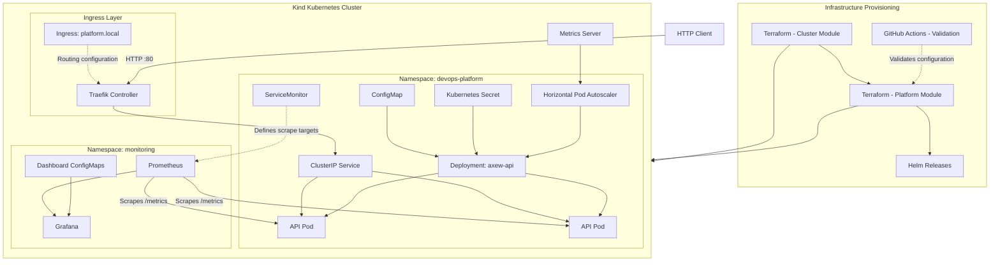

# Axew — Architecture

## 1. Overview

Axew is a local DevOps platform designed to demonstrate infrastructure provisioning, container orchestration, observability, autoscaling, and infrastructure validation.

The environment runs on a local Kubernetes cluster provisioned with Kind. Terraform manages both the cluster infrastructure and the Kubernetes resources deployed inside it.

The application is a lightweight Flask API containerized with Docker and deployed to Kubernetes.

The platform includes:

- Terraform for infrastructure provisioning and resource management.
- Kind for running a local Kubernetes cluster.
- Docker for application containerization.
- Kubernetes for workload orchestration.
- Helm for installing platform components.
- Traefik for HTTP ingress.
- Metrics Server and HPA for resource metrics and autoscaling.
- Prometheus for metrics collection.
- Grafana for visualization and dashboards.
- GitHub Actions for automated infrastructure validation.

## 2. Architecture Diagram



## 3. Infrastructure Components

### 3.1 Infrastructure Provisioning

Terraform is divided into two independent modules.

| Module               | Responsibility                                  |
| -------------------- | ----------------------------------------------- |
| `terraform/cluster`  | Creates and manages the Kind cluster.           |
| `terraform/platform` | Manages Kubernetes resources and Helm releases. |

The cluster module provisions:

- One control-plane node.
- Configurable worker nodes.
- Kubernetes node image `kindest/node:v1.34.0`.
- Kubeconfig configuration.

The platform module manages the application, ingress, autoscaling, and monitoring resources.

Terraform state is maintained locally in each module and must not be committed to the repository.

### 3.2 Kubernetes Cluster

The local cluster runs using Kind.

Its topology consists of:

- One control-plane node.
- One worker node by default.

The worker count can be configured through Terraform variables.

The cluster provides the Kubernetes environment used by all application and monitoring workloads.

### 3.3 Ingress Layer

Traefik is installed using Helm.

Its configuration includes:

- A single controller replica.
- Deployment on the control-plane node.
- HTTP exposure through host port 80.
- Kubernetes Ingress provider enabled.
- IngressClass named `traefik`.

The application is exposed through the hostname:

`platform.local`

The Ingress resource forwards HTTP requests to the application's internal Kubernetes Service.

### 3.4 Application Layer

The application is a Flask API running with Gunicorn.

The Docker image uses Python 3.12 slim and runs under an unprivileged user with UID 10001.

The application exposes:

| Endpoint   | Purpose                              |
| ---------- | ------------------------------------ |
| `/`        | Application information and version. |
| `/health`  | Liveness health check.               |
| `/ready`   | Readiness health check.              |
| `/metrics` | Prometheus metrics endpoint.         |

The Kubernetes Deployment includes:

- Two initial replicas.
- CPU and memory requests and limits.
- Liveness and readiness probes.
- ConfigMap and Secret environment variables.
- Non-root execution.
- Read-only root filesystem.
- Dropped Linux capabilities.
- Restricted privilege escalation.

The application is exposed internally through a ClusterIP Service on port 80, forwarding traffic to container port 8080.

### 3.5 Autoscaling

The Horizontal Pod Autoscaler manages the number of application replicas based on CPU utilization.

| Setting                | Value |
| ---------------------- | ----: |
| Minimum replicas       |     2 |
| Maximum replicas       |     5 |
| Target CPU utilization |   70% |

Metrics Server provides resource metrics to Kubernetes.

The HPA uses these metrics to adjust the Deployment replica count.

Terraform ignores changes to the Deployment replica field to avoid conflicting with the HPA's runtime scaling decisions.

### 3.6 Monitoring and Observability

The monitoring stack is installed using the `kube-prometheus-stack` Helm chart.

Its main components are:

**Prometheus**

- Collects application and Kubernetes metrics.
- Uses a three-day retention period.
- Uses a 30-second scrape interval.
- Discovers ServiceMonitors across namespaces.

**Grafana**

- Provides dashboards for application and Kubernetes observability.
- Uses ConfigMaps for dashboard provisioning.
- Discovers dashboards through the Grafana sidecar.
- Runs without persistent storage in this laboratory environment.

**Metrics Server**

- Provides resource metrics used by the HPA.

Alertmanager is disabled in the current implementation.

### 3.7 Dashboards

Grafana dashboards are maintained as JSON files in:

```text
monitoring/
├── dashboards/
│   ├── axew-api.json
│   ├── kubernetes-hpa.json
│   └── kubernetes-overview.json
└── values.yaml
```

Terraform creates ConfigMaps from these dashboard files.

Grafana's dashboard sidecar detects the ConfigMaps and provisions the dashboards automatically.

## 4. Communication Flow

### 4.1 Application Request Flow

1. An HTTP client sends a request to `platform.local`.
2. Traefik receives the request through its HTTP entry point.
3. The Ingress resource routes the request to the `axew-api` Service.
4. The Service forwards traffic to an available application Pod.
5. The Flask API processes the request and returns an HTTP response.

### 4.2 Metrics Collection Flow

1. The application exposes Prometheus metrics through `/metrics`.
2. The ServiceMonitor identifies the application Service.
3. Prometheus discovers the ServiceMonitor and scrapes the application endpoints.
4. Metrics are stored in Prometheus.
5. Grafana queries Prometheus to display dashboards.

### 4.3 Autoscaling Flow

1. Metrics Server collects resource utilization information.
2. The Kubernetes Metrics API makes resource metrics available.
3. The HPA evaluates the application's CPU utilization.
4. When the configured target is exceeded, the HPA adjusts the Deployment replica count.
5. Kubernetes schedules additional Pods when required.

## 5. Provisioning Workflow

The infrastructure is provisioned in two stages.

```text
Terraform Cluster Module
          |
          v
     Kind Cluster
          |
          v
Terraform Platform Module
          |
          +------> Traefik
          |
          +------> Metrics Server
          |
          +------> Application Resources
          |
          +------> Horizontal Pod Autoscaler
          |
          +------> Prometheus and Grafana
          |
          v
    Operational Platform
```

The separation allows the Kubernetes cluster lifecycle to be managed independently from the workloads and platform components.

## 6. Security Considerations

The application container follows several security practices:

- Runs as a non-root user.
- Uses a read-only root filesystem.
- Drops all Linux capabilities.
- Disables privilege escalation.
- Uses the RuntimeDefault seccomp profile.
- Receives configuration through a ConfigMap and a Kubernetes Secret.

The Metrics Server currently uses `--kubelet-insecure-tls` to accommodate the local Kind laboratory environment.

This setting disables kubelet serving certificate verification and must not be treated as a production security configuration.

The current environment is intended for development and demonstration purposes, not as a production-ready deployment.

## 7. Known Limitations

- Kind runs locally and is not a production Kubernetes distribution.
- Grafana persistence is disabled.
- Alertmanager is disabled.
- Prometheus retention is limited to three days.
- Terraform state is stored locally.
- Metrics Server uses an insecure kubelet TLS configuration for the laboratory environment.
- The platform does not currently include a production-grade secret management solution.

## 8. Repository Structure

```text
axew/
├── .github/
│   └── workflows/
│       └── terraform-validation.yml
├── application/
│   ├── app.py
│   ├── Dockerfile
│   └── requirements.txt
├── docs/
├── monitoring/
│   ├── dashboards/
│   └── values.yaml
├── terraform/
│   ├── cluster/
│   └── platform/
├── .gitignore
├── .tflint.hcl
└── README.md
```
